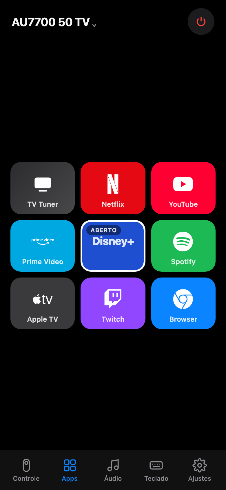
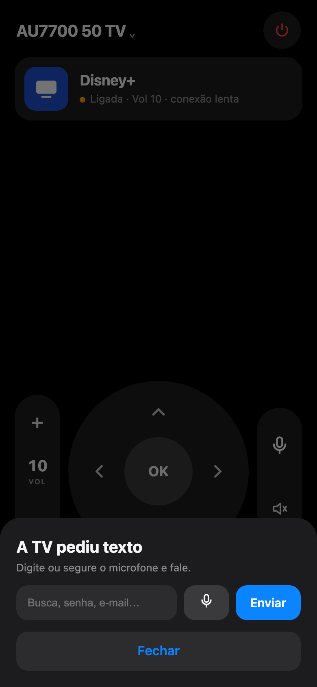
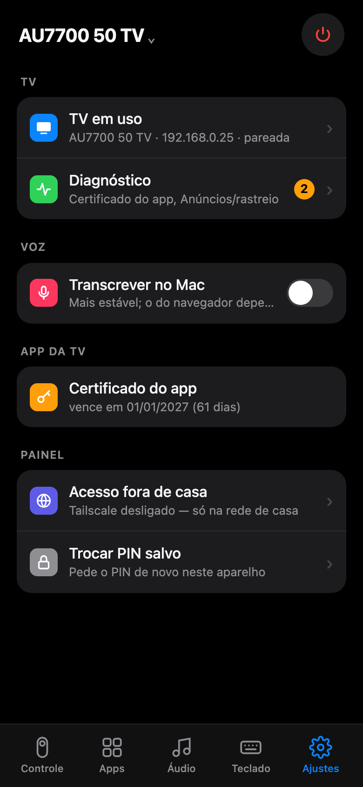

# TV Tuner

Controle remoto, voz e tela inicial própria para TV Samsung (Tizen), pela rede de casa.
Sem nuvem, sem app da loja, sem anúncio.

<p>
  
  
  
  
</p>

- **Controle no celular:** D-pad com joystick, volume ao segurar, apps com logo, estado ao vivo.
- **Voz:** segure o microfone e fale ("abrir netflix", "volume 20", "buscar stranger things"). Transcrição local com whisper.
- **Teclado:** se a TV abre um campo de texto, o celular abre um teclado.
- **Várias TVs:** acha na rede, pareia, troca. Abrir app e mudar volume funcionam sem parear.
- **Doctor:** confere rede, pareamento, modo desenvolvedor, certificado e bloqueio de anúncio.
- **Tela inicial Tizen:** relógio, favoritos e HDMI, sem anúncio.

## Setup com IA

Cole no Claude Code (ou outro agente com terminal) dentro desta pasta:

```text
Configure o TV Tuner neste computador para a minha TV Samsung.

1. Instale as dependências: pip3 install -r requirements.txt; whisper.cpp e ffmpeg (brew).
2. Rode ./tv discover e ./tv pair. Eu aceito "Permitir" na TV.
3. Rode ./tv doctor e me explique cada aviso. Corrija o que for automático.
4. Suba o painel como serviço: ./tv service install --pin <escolha um PIN de 4 dígitos>.
   Baixe o modelo whisper large-v3-turbo q5_0 em ~/.config/tv-tuner/whisper/.
5. Me dê a URL https do painel para abrir no celular, na mesma rede.
6. Opcional: instale a tela inicial (tizen/README.md). Me guie no Modo Desenvolvedor da TV.

Regras: não abra porta no roteador; token, PIN e etiqueta da TV não vão para o git.
```

## Na mão

```sh
pip3 install -r requirements.txt
./tv discover && ./tv pair
./tv doctor
./tv panel --pin 1234        # http://<ip>:8780 · https://<ip>:8743 (microfone)
./tv service install --pin 1234
```

`./tv --help` lista o resto: teclas, macros, apps, texto, navegador, liga/desliga, checklist.

## Como fala com a TV

| Porta | Uso | Precisa parear |
|---|---|---|
| 8001 | info, abrir app | não |
| 8002 | teclas, texto, desligar | sim |
| 9197 | volume, mudo, mídia (UPnP) + eventos ao vivo | não |
| 26101 | instalar o app Tizen (SDB) | modo dev |

Testado na UN50AU7700 (2021, Tizen 6). Outras Samsung Tizen devem funcionar; TV 2023+ exige certificado Samsung para o app.

## DNS

`dns/blocklist.txt` (seguro) e `dns/blocklist-agressivo.txt` (pode quebrar loja). Use no NextDNS, Pi-hole ou AdGuard Home.

## Créditos

Instalador SDB baseado em [free-my-tv](https://github.com/simbasjungles/free-my-tv) (MIT).
Notas do Tizen em [cleanyourtv](https://github.com/Gathin23/cleanyourtv).
Lista agressiva de [Perflyst/PiHoleBlocklist](https://github.com/Perflyst/PiHoleBlocklist).
Ícones de [Simple Icons](https://simpleicons.org).

## Licença

MIT
