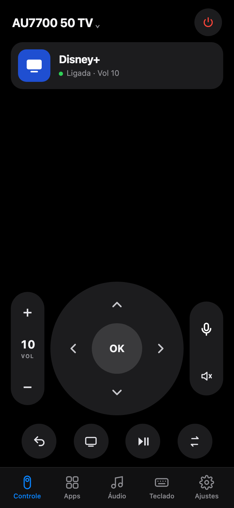

# TV Tuner



Phone remote, voice control and an ad-free home screen for Samsung Tizen TVs.
Runs on your home network. No cloud, no store app, no ads.

- **Remote:** D-pad with joystick drag, hold-to-repeat volume, app logos, live state.
- **Voice:** hold the mic and speak ("open netflix", "volume 20", "search stranger things"). Local transcription with whisper.
- **Keyboard:** when the TV opens a text field, your phone opens one too.
- **Multi-TV:** discover, pair, switch. Apps and volume work even without pairing.
- **Doctor:** checks network, pairing, developer mode, app certificate and ad blocking.
- **Home screen:** Tizen app with clock, favorites and HDMI inputs.

<br clear="right">

## Set up with AI

Paste this into Claude Code (or any agent with a terminal) inside this folder:

```text
Set up TV Tuner on this computer for my Samsung TV.

1. Install dependencies: pip3 install -r requirements.txt; whisper.cpp and ffmpeg (brew).
2. Run ./tv discover and ./tv pair. I'll accept "Allow" on the TV.
3. Run ./tv doctor, explain each warning and fix what can be fixed automatically.
4. Run the panel as a service: ./tv service install --pin <pick a 4-digit PIN>.
   Download the whisper large-v3-turbo q5_0 model into ~/.config/tv-tuner/whisper/.
5. Give me the panel's https URL to open on my phone, on the same network.
6. Optional: install the home screen (tizen/README.md) and walk me through the TV's Developer Mode.

Rules: never open router ports; token, PIN and the TV's label never go into git.
```

## Manual

```sh
pip3 install -r requirements.txt
./tv discover && ./tv pair
./tv doctor
./tv panel --pin 1234        # http://<ip>:8780 · https://<ip>:8743 (mic needs https)
./tv service install --pin 1234
```

`./tv --help` lists the rest: keys, macros, apps, text, browser, power, checklist.

## How it talks to the TV

| Port | Used for | Pairing |
|---|---|---|
| 8001 | info, open apps | no |
| 8002 | keys, text, power off | yes |
| 9197 | volume, mute, media (UPnP) + live events | no |
| 26101 | install the Tizen app (SDB) | developer mode |

Tested on a UN50AU7700 (2021, Tizen 6). Other Tizen Samsungs should work; 2023+ models need a Samsung certificate for the app.

## DNS

`dns/blocklist.txt` (safe) and `dns/blocklist-agressivo.txt` (may break the store). Use with NextDNS, Pi-hole or AdGuard Home.

## Credits

SDB installer based on [free-my-tv](https://github.com/simbasjungles/free-my-tv) (MIT).
Tizen notes from [cleanyourtv](https://github.com/Gathin23/cleanyourtv).
Aggressive list from [Perflyst/PiHoleBlocklist](https://github.com/Perflyst/PiHoleBlocklist).
Icons from [Simple Icons](https://simpleicons.org).

## License

MIT
